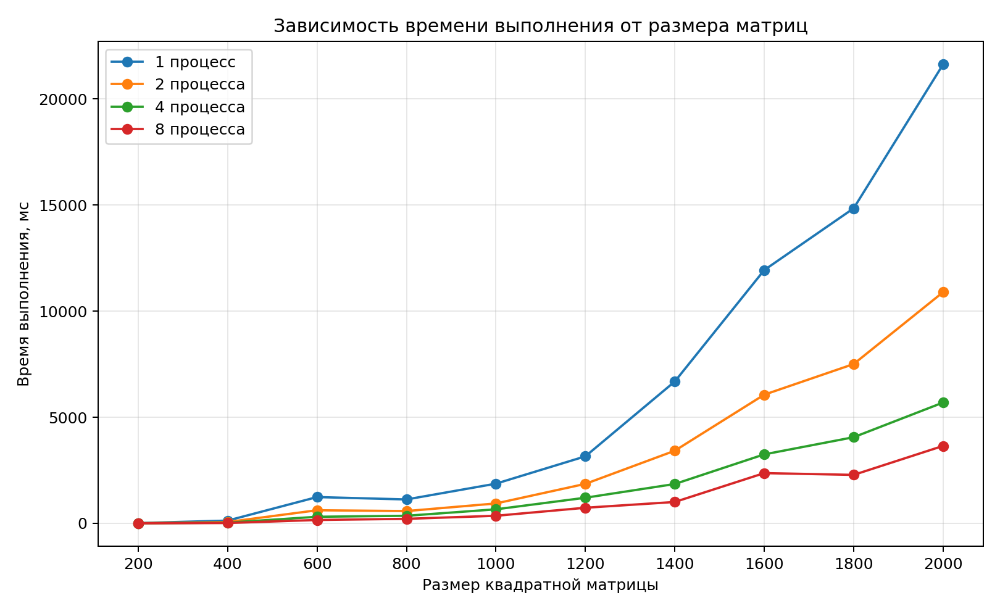

# Лабораторная работа №3 — MPI

## Цель работы

Изучить технологию параллельных вычислений с использованием MPI (Message Passing Interface), реализовать параллельное умножение матриц и исследовать зависимость времени выполнения программы от размера матриц и количества MPI-процессов.

## Описание реализации 

В программе используется модель обмена сообщениями MPI. Процесс с рангом 0 считывает входные матрицы A и B из файлов и проверяет совместимость их размеров для умножения.

Размеры матриц передаются всем процессам с помощью `MPI_Bcast`. Матрица B также рассылается всем процессам с помощью `MPI_Bcast`. Строки матрицы A распределяются между процессами с помощью `MPI_Scatterv`. Распределение выполняется по строкам: каждому процессу назначается примерно одинаковое количество строк, а остаток по одной строке получают первые процессы.

Каждый процесс вычисляет соответствующие строки результирующей матрицы C, используя три вложенных цикла. После вычислений части результирующей матрицы собираются на процессе с рангом 0 с помощью `MPI_Gatherv`. Главный процесс сохраняет итоговую матрицу в файл.

Измерение времени начинается после рассылки матрицы B и барьера синхронизации. Поэтому измеряемый интервал включает распределение строк матрицы A, локальные вычисления и сбор результирующей матрицы, но не включает чтение входных файлов и рассылку матрицы B.

## Условия эксперимента

Эксперименты проводились на суперкомпьютере «Сергей Королёв» с использованием Intel MPI.

Исследовались квадратные матрицы размером от 200 × 200 до 2000 × 2000 с шагом 200. Для каждого размера выполнялись запуски с 1, 2, 4 и 8 MPI-процессами.

Входные матрицы генерировались случайным образом. Для каждого размера один и тот же набор входных матриц использовался во всех четырёх конфигурациях количества процессов.

## Результаты измерений

### Время выполнения
В таблице представлены результаты измерений времени выполнения программы

| Размер | 1 процесс, мс | 2 процесса, мс | 4 процесса, мс | 8 процессов, мс |
|---|---:|---:|---:|---:|
| 200 × 200 | 13.5379 | 6.28495 | 3.2351 | 1.87707 |
| 400 × 400 | 129.796 | 64.276 | 32.331 | 16.5131 |
| 600 × 600 | 1239.1 | 617.33 | 309.869 | 159.139 |
| 800 × 800 | 1126.68 | 579.317 | 356.416 | 212.764 |
| 1000 × 1000 | 1870.29 | 937.803 | 661.523 | 356.411 |
| 1200 × 1200 | 3158.1 | 1860.64 | 1207.08 | 735.379 |
| 1400 × 1400 | 6684.73 | 3422.56 | 1854.33 | 1007.28 |
| 1600 × 1600 | 11935.7 | 6062.94 | 3250.55 | 2367.58 |
| 1800 × 1800 | 14847 | 7507.64 | 4059.53 | 2284.06 |
| 2000 × 2000 | 21628.4 | 10895.9 | 5693.28 | 3649.86 |

### Расчёт ускорения
Ускорение вычислялось по формуле:
$$S(p)=\frac{T(1)}{T(p)}$$
где T(1) — время выполнения с одним процессом, T(p) — время выполнения с p процессами.

Полученные значения ускорения:

| Размер матриц | 2 процесса | 4 процесса | 8 процессов |
|---|---:|---:|---:|
| 200 × 200 | 2.15 | 4.18 | 7.21 |
| 400 × 400 | 2.02 | 4.01 | 7.86 |
| 600 × 600 | 2.01 | 4.00 | 7.79 |
| 800 × 800 | 1.94 | 3.16 | 5.30 |
| 1000 × 1000 | 1.99 | 2.83 | 5.25 |
| 1200 × 1200 | 1.70 | 2.62 | 4.29 |
| 1400 × 1400 | 1.95 | 3.60 | 6.64 |
| 1600 × 1600 | 1.97 | 3.67 | 5.04 |
| 1800 × 1800 | 1.98 | 3.66 | 6.50 |
| 2000 × 2000 | 1.99 | 3.80 | 5.93 |

.png)

### Эффективность параллельных вычислений

Эффективность вычислялась по формуле: $$E(p)=\frac{S(p)}{p}\cdot100%$$

Она показывает, насколько эффективно используются дополнительные MPI-процессы относительно идеального линейного ускорения.

| Размер | 2 процесса, % | 4 процесса, % | 8 процессов, % |
| ---: | ---: | ---: | ---: |
| 200 × 200 | 107.70 | 104.62 | 90.15 |
| 400 × 400 | 100.97 | 100.36 | 98.25 |
| 600 × 600 | 100.36 | 99.97 | 97.33 |
| 800 × 800 | 97.24 | 79.03 | 66.19 |
| 1000 × 1000 | 99.72 | 70.68 | 65.59 |
| 1200 × 1200 | 84.87 | 65.41 | 53.68 |
| 1400 × 1400 | 97.66 | 90.12 | 82.96 |
| 1600 × 1600 | 98.43 | 91.80 | 63.02 |
| 1800 × 1800 | 98.88 | 91.43 | 81.25 |
| 2000 × 2000 | 99.25 | 94.97 | 74.07 |

## Анализ результатов

Во всех проведённых измерениях увеличение числа MPI-процессов приводило к уменьшению времени выполнения программы.

Для матриц 400 × 400 и 600 × 600 наблюдалось ускорение, близкое к линейному: при использовании восьми процессов оно составило приблизительно 7,86 и 7,79 раза соответственно.

Для матрицы 2000 × 2000 ускорение составило приблизительно 1,99 раза при двух процессах, 3,80 раза при четырёх процессах и 5,93 раза при восьми процессах. Таким образом, параллельное выполнение заметно сокращает время вычислений, однако ускорение не достигает идеального линейного значения.

На эффективность влияют затраты на распределение и сбор данных, синхронизацию процессов, а также особенности нагрузки вычислительного узла. Кроме того, измеряемый интервал включает операции `MPI_Scatterv` и `MPI_Gatherv`, но не включает начальное чтение файлов и рассылку матрицы B.

В отдельных точках наблюдаются отклонения от плавного роста времени с увеличением размера матриц. Например, измерение для 800 × 800 с одним процессом оказалось быстрее измерения для 600 × 600. Такие отклонения могут быть связаны с изменением системной нагрузки и условиями выполнения заданий. Поскольку повторные измерения не проводились, результаты следует рассматривать как полученные значения отдельных запусков.

Для небольших матриц относительное влияние накладных расходов и погрешности измерений выше, поскольку само время вычислений невелико.

## Вывод

В ходе лабораторной работы была реализована программа параллельного умножения матриц с использованием MPI. Для распределения данных применялась операция `MPI_Scatterv`, для передачи матрицы B — `MPI_Bcast`, а для сбора результатов — `MPI_Gatherv`.

Были проведены 40 измерений для десяти размеров матриц и четырёх вариантов количества MPI-процессов. Эксперименты показали, что увеличение количества процессов позволяет сократить время выполнения программы. При этом эффективность параллельного выполнения зависит от размера задачи и накладных расходов на обмен данными и синхронизацию.

Таким образом, MPI позволяет ускорить вычисление произведения матриц за счёт распределения строк между процессами, однако фактическое ускорение зависит от условий выполнения и не всегда соответствует идеальному линейному масштабированию.

