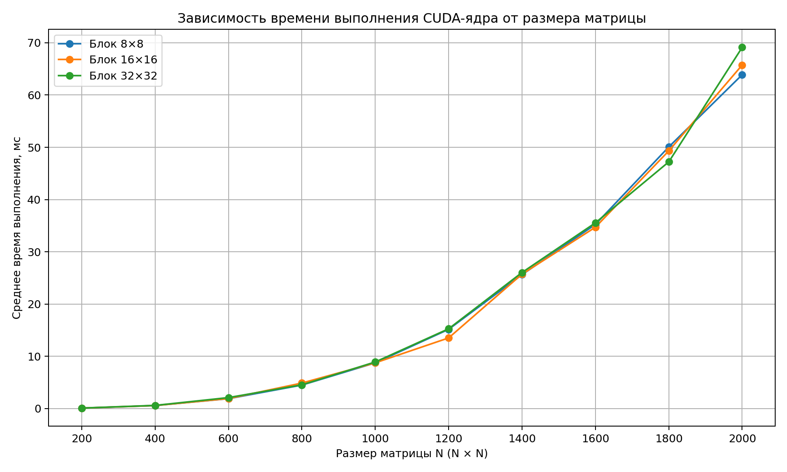
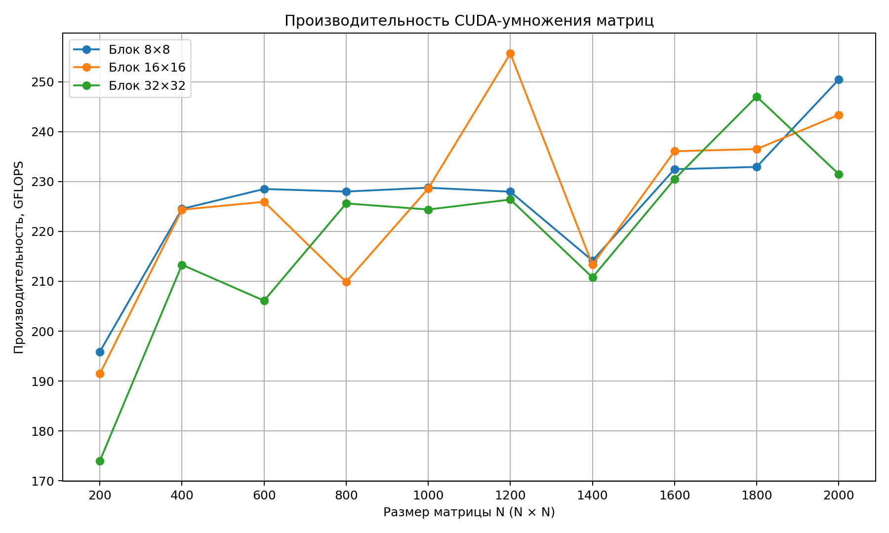

# Лабораторная работа №4. Умножение матриц с использованием CUDA

## Цель работы

Изучить основы разработки параллельных программ с использованием CUDA, реализовать умножение двух матриц на графическом процессоре и исследовать влияние размера потокового блока на производительность вычислений.

## Программно-аппаратная среда

- Операционная система: Windows.
- Видеокарта: NVIDIA GeForce RTX 4060, 8 ГБ видеопамяти.
- Драйвер NVIDIA: 581.29.
- CUDA Toolkit: 13.5.37.
- Компилятор: MSVC 14.51.36231 (Visual Studio 2026 Community).
- CMake: 4.4.0.
- Python: 3.12.3.
- NumPy: 2.5.3.

## Реализация

Входные данные представляют собой две квадратные матрицы A и B одинакового размера N × N. Элементы матриц генерируются случайным образом в диапазоне от −100 до 100 и сохраняются в текстовые файлы.

Матрицы хранятся в линейных массивах. Перед вычислениями память под входные и выходную матрицы выделяется на видеокарте с помощью CUDA Runtime API. Затем входные данные копируются из оперативной памяти на устройство.

CUDA-ядро выполняет вычисление одного элемента результирующей матрицы C одним CUDA-потоком. Индексы строки и столбца определяются по координатам потока в сетке блоков:

- индекс строки определяется координатой `blockIdx.y` и `threadIdx.y`;
- индекс столбца определяется координатой `blockIdx.x` и `threadIdx.x`.

Каждый поток вычисляет скалярное произведение соответствующей строки матрицы A и соответствующего столбца матрицы B. Потоки, индексы которых выходят за границы матрицы, не выполняют вычисления.

Размер блока задаётся при запуске программы. В эксперименте использовались блоки 8×8, 16×16 и 32×32. Размер сетки рассчитывается с округлением вверх, чтобы покрыть все элементы матрицы:

```cpp
dim3 blockSize(blockDimension, blockDimension);

dim3 gridSize(
    (B.cols + blockSize.x - 1) / blockSize.x,
    (A.rows + blockSize.y - 1) / blockSize.y
);
```

После выполнения ядра результирующая матрица копируется обратно на CPU и сохраняется в `output/result.txt`.

## Методика эксперимента

Исследовались квадратные матрицы размером от 200×200 до 2000×2000 с шагом 200. Для каждого размера выполнялись запуски с тремя конфигурациями блока: 8×8, 16×16 и 32×32.

Время измерялось с помощью CUDA Events. Перед измерениями выполнялся прогревочный запуск ядра. Затем ядро запускалось пять раз, а в таблицу заносилось среднее время выполнения. Время копирования данных между CPU и GPU в измерение времени ядра не включалось.

Для оценки производительности использовалась оценка количества операций для умножения квадратных матриц — 2N³ операций:


$$GFLOPS = \frac{2N^3}{t_{ms} \cdot 10^6}$$

где N — размер квадратной матрицы, а t_ms — среднее время выполнения ядра в миллисекундах.

## Результаты измерений

Среднее время выполнения CUDA-ядра, мс:

| Размер матрицы | Блок 8×8 | Блок 16×16 | Блок 32×32 |
|---:|---:|---:|---:|
| 200 | 0.081677 | 0.083558 | 0.091955 |
| 400 | 0.570118 | 0.570515 | 0.600064 |
| 600 | 1.890510 | 1.912010 | 2.095920 |
| 800 | 4.491280 | 4.879160 | 4.538780 |
| 1000 | 8.742710 | 8.748440 | 8.912900 |
| 1200 | 15.160300 | 13.517600 | 15.265600 |
| 1400 | 25.626400 | 25.726600 | 26.036400 |
| 1600 | 35.238100 | 34.700700 | 35.543700 |
| 1800 | 50.073800 | 49.318300 | 47.212900 |
| 2000 | 63.888400 | 65.745100 | 69.117500 |

Производительность, GFLOPS:

| Размер матрицы | Блок 8×8 | Блок 16×16 | Блок 32×32 |
|---:|---:|---:|---:|
| 200 | 195.89 | 191.48 | 174.00 |
| 400 | 224.51 | 224.36 | 213.31 |
| 600 | 228.51 | 225.94 | 206.11 |
| 800 | 228.00 | 209.87 | 225.61 |
| 1000 | 228.76 | 228.61 | 224.39 |
| 1200 | 227.96 | 255.67 | 226.39 |
| 1400 | 214.15 | 213.32 | 210.78 |
| 1600 | 232.48 | 236.08 | 230.48 |
| 1800 | 232.94 | 236.50 | 247.05 |
| 2000 | 250.44 | 243.36 | 231.49 |

Наиболее быстрая конфигурация для каждого размера:

| Размер матрицы | Самый быстрый блок | Время, мс |
|---:|---:|---:|
| 200 | 8×8 | 0.081677 |
| 400 | 8×8 | 0.570118 |
| 600 | 8×8 | 1.890510 |
| 800 | 8×8 | 4.491280 |
| 1000 | 8×8 | 8.742710 |
| 1200 | 16×16 | 13.517600 |
| 1400 | 8×8 | 25.626400 |
| 1600 | 16×16 | 34.700700 |
| 1800 | 32×32 | 47.212900 |
| 2000 | 8×8 | 63.888400 |

## Графики

### Время выполнения



### Производительность



## Проверка корректности

Корректность результата проверялась с помощью скрипта `verify.py`, который сравнивает вычисленную матрицу с эталонным результатом, полученным средствами NumPy. Проверка последнего выполненного запуска завершилась успешно.

## Выводы

В ходе лабораторной работы была реализована программа умножения матриц с использованием CUDA. Были исследованы три конфигурации потоковых блоков на десяти размерах квадратных матриц, всего выполнено 30 измерений.

Эксперимент показал, что время выполнения ядра увеличивается с ростом размера матриц. При этом производительность в GFLOPS не является строго постоянной и зависит от размера входных данных и конфигурации блока.

Единственная конфигурация, которая была бы оптимальной для всех размеров матриц, не выявлена. Для большинства исследованных размеров наименьшее время показал блок 8×8. Для размеров 1200×1200 и 1600×1600 быстрее оказался блок 16×16, а для 1800×1800 — блок 32×32. На размере 2000×2000 снова лучшим оказался блок 8×8.

Таким образом, увеличение количества потоков в блоке не гарантирует ускорения вычислений. Выбор конфигурации CUDA-блока влияет на производительность, а оптимальный вариант зависит от размера обрабатываемых данных и особенностей архитектуры GPU.

Результат вычислений был проверен сравнением с эталонным результатом NumPy; проверка завершилась успешно.
